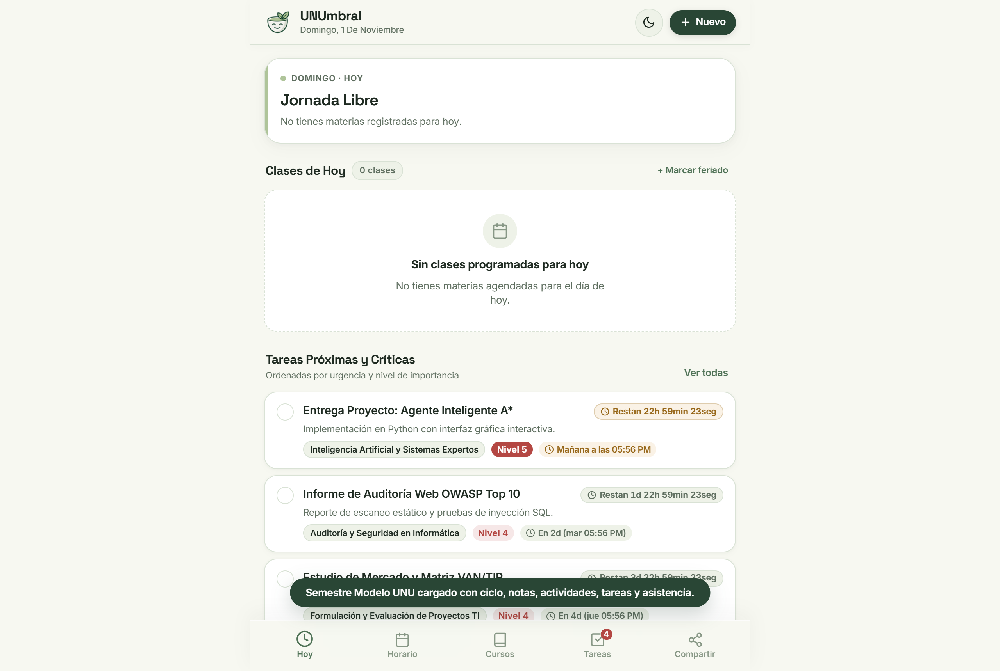
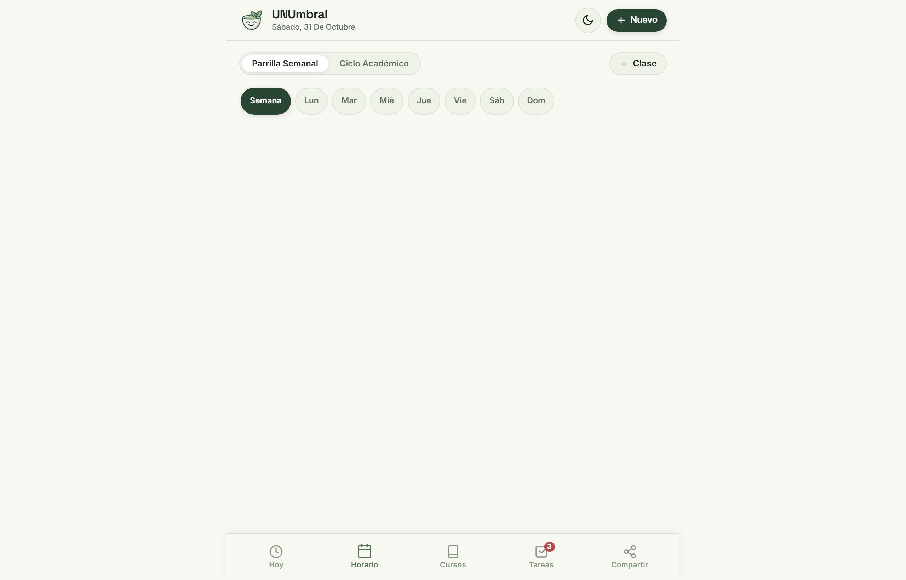
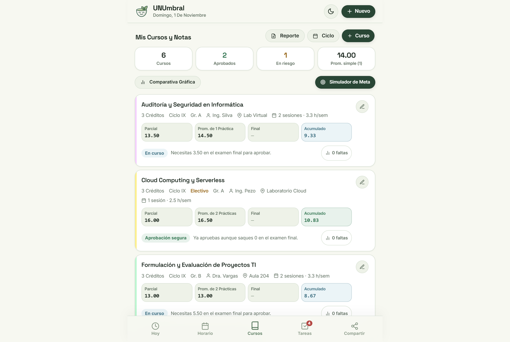
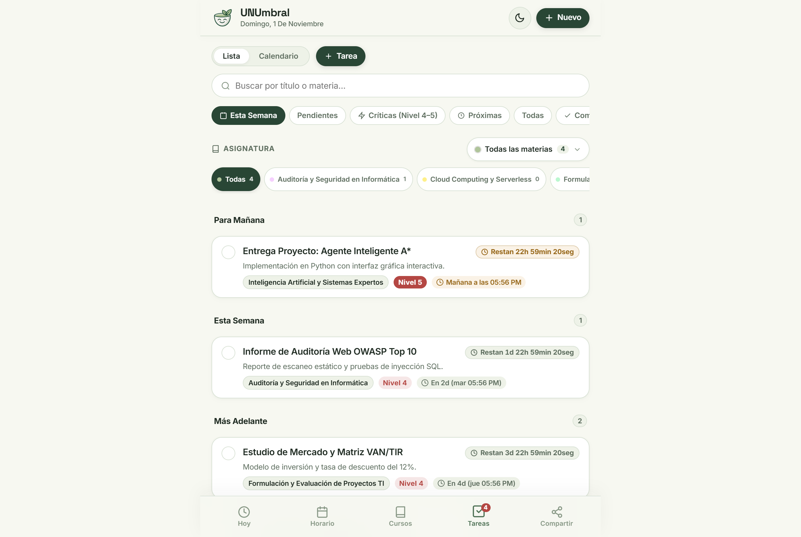
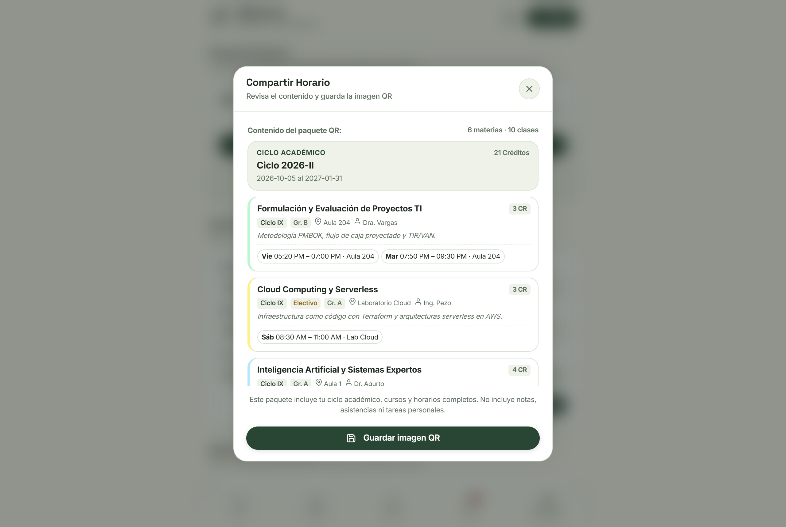
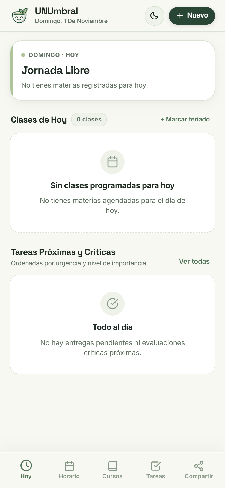

# UNUmbral — Organizador académico universitario 100% offline

> Aplicación web progresiva (PWA) y cliente nativo Android con arquitectura Local-First para gestión de ciclos universitarios de 17 semanas, horarios en formato 12 horas (AM/PM), notas en escala vigesimal (0 a 20) con redondeo a 10.5, control de inasistencias por sesión y transferencia de horarios mediante códigos QR comprimidos con Deflate sin conexión ni servidores.

[](https://github.com/TeVerde29/UNUmbral)
[](https://teverde29.github.io/UNUmbral/)
[](https://dexie.org/)
[](https://capacitorjs.com/)
[](tests/)
[](LICENSE)

---

## Capturas

| Vista Principal y Próxima Clase (`view-hoy`) | Parrilla Semanal de Horario (`view-horario`) |
|:---:|:---:|
|  |  |

| Catálogo de Asignaturas y Notas (`view-cursos`) | Planificador de Tareas por Urgencia (`view-tareas`) |
|:---:|:---:|
|  |  |

| Resumen y Exportación de Horario por QR | Interfaz en Dispositivo Móvil |
|:---:|:---:|
|  |  |

---

Los estudiantes universitarios gestionan sus asignaturas, bloques de clases y fechas límite en un entorno local sin intermediarios. La aplicación proyecta automáticamente las 17 semanas del semestre, calcula promedios ponderados en escala vigesimal, descuenta inasistencias según el artículo 31 del reglamento académico, emite alarmas sonoras previas a cada sesión y permite intercambiar la carga lectiva con otros estudiantes mediante códigos QR comprimidos sin compartir calificaciones ni notas privadas.

---

## Tabla de contenidos

1. [Descripción](#descripción)
2. [Producción y Descarga](#producción-y-descarga)
3. [Características Principales](#características-principales)
4. [Stack Tecnológico](#stack-tecnológico)
5. [Arquitectura del Sistema](#arquitectura-del-sistema)
6. [Instalación y Uso](#instalación-y-uso)
7. [Requisitos del Sistema](#requisitos-del-sistema)
8. [Modelo de Datos](#modelo-de-datos)
9. [Formato de Intercambio QR](#formato-de-intercambio-qr)
10. [Reglas Académicas del Dominio](#reglas-académicas-del-dominio)
11. [Pruebas Automatizadas](#pruebas-automatizadas)
12. [Compilación Nativa Android](#compilación-nativa-android)
13. [Licencia](#licencia)
14. [Autor](#autor)

---

## Descripción

En aulas universitarias, sótanos de laboratorios y transporte público la conectividad celular suele ser deficiente o nula. La mayoría de organizadores académicos comerciales requieren inicio de sesión obligatorio en la nube, sincronizan datos con servidores remotos o monetizan hábitos estudiantiles.

UNUmbral opera bajo una arquitectura Local-First y Zero-Tracking estricta. Todos los datos residen en la base de datos `IndexedDB` del navegador o dispositivo móvil mediante Dexie.js v4.4.4. El Service Worker implementa una estrategia de caché *Stale-While-Revalidate* que garantiza la disponibilidad del sistema completo de forma indefinida tras la primera visita.

El sistema no delega la lógica de negocio a un backend: la proyección del semestre a 17 semanas (`lib/asistencia.js`), el cálculo del promedio ponderado vigesimal (`lib/rendimiento.js`), la compresión binaria Deflate de horarios (`lib/qr.js`) y la priorización de tareas (`lib/prioridad.js`) se calculan en el cliente en tiempo real. Para compartir un horario, se genera un código QR comprimido de alta densidad que otro estudiante lee con su cámara o desde una captura de pantalla, transfiriendo únicamente la estructura académica y omitiendo notas, faltas y tareas personales.

---

## Producción y Descarga

| Entorno / Recurso | Plataforma | Enlace / Ubicación |
|---|---|---|
| **Aplicación Web (PWA)** | GitHub Pages | [https://teverde29.github.io/UNUmbral/](https://teverde29.github.io/UNUmbral/) |
| **Código Fuente** | GitHub Repository | [https://github.com/TeVerde29/UNUmbral](https://github.com/TeVerde29/UNUmbral) |
| **Política de Privacidad** | Repositorio local | [PRIVACY.md](PRIVACY.md) |
| **Paquete Nativo Android** | Debug APK (local) | `android/app/build/outputs/apk/debug/app-debug.apk` |

---

## Características Principales

- **Gestión semestral de 17 semanas lectivas:** Proyección automática a partir de cualquier lunes de inicio. La semana 8 se etiqueta para exámenes parciales y la semana 17 para exámenes finales y cierre de actas.
- **Horario en formato 12 horas (AM/PM) con Parrilla Semanal por defecto:** Renderizado de bloques de lunes a domingo con selector de hora independiente AM/PM y chips de selección múltiple (incluyendo botón rápido `[Lun a Vie]`).
- **Filtrado de clases canceladas en estado en vivo:** La tarjeta de próxima clase en la vista Hoy detecta excepciones de fechas y clases suspendidas para no mostrar como activa una sesión cancelada.
- **Calculadora de notas en escala vigesimal (0 a 20):** Cálculo de promedio final con regla reglamentaria:
  $$\text{Promedio Final} = \frac{\text{Examen Parcial} + \text{Examen Final} + \text{Promedio Prácticas}}{3}$$
  Aprobación con nota mínima de 10.5 (redondeo a entero superior) y cálculo de promedio ponderado general acumulado por créditos.
- **Control de inasistencias con alertas preventivas:** Detección de umbrales reglamentarios al 10%, 20% y 30% de faltas sobre el total de sesiones programadas. Las clases pasadas se computan asistidas por defecto a menos que se registre inasistencia o justificación expresa.
- **Planificador de tareas con matriz de criticidad:** Clasificación de entregas por 5 niveles de importancia. Detección automática de huecos libres entre clases ($\ge 30$ minutos) para sugerir avances.
- **Exportación e importación óptica por QR con compresión Deflate (Zlib):** Serialización ultra-compacta con biblioteca `pako` (prefijo `UNU1:Z:`), vista previa de contenido antes de exportar y compatibilidad con horarios extensos mediante códigos QR multipartes.
- **Notificaciones nativas locales en Android:** Avisos automáticos a 30 y 10 minutos antes de cada clase y alarmas para entregas críticas sin requerir conexión a internet ni servicios de mensajería en la nube.

---

## Stack Tecnológico

| Capa | Tecnología | Versión | Función en el sistema |
|---|---|---|---|
| **Lenguaje Core** | JavaScript Vanilla (ES6+) | Estándar | Lógica modular, manipulaciones DOM seguras y algoritmos de proyección. |
| **Base de Datos Local** | Dexie.js | 4.4.4 | Capa relacional estructurada sobre IndexedDB con versionado y transacciones. |
| **Compresión de Datos** | Pako (Zlib Deflate/Inflate) | 3.0.3 | Compresión binaria en memoria para códigos QR de alta densidad. |
| **Generación QR** | qrcode-generator | 2.0.4 | Generador vectorial de códigos QR en lienzo Canvas. |
| **Escaneo QR** | jsQR | 1.4.0 | Reconocimiento óptico de códigos QR desde imágenes o flujo de cámara. |
| **Contenedor Móvil** | Capacitor Android | 8.5.3 | Envoltura nativa para compilar APK y puente hacia Android SDK. |
| **Notificaciones Locales** | `@capacitor/local-notifications` | 8.3.1 | Alarmas y recordatorios programados en el gestor del sistema operativo. |
| **Diseño y Estilos** | CSS3 Nativo (Design Ricra) | Estándar | Tokens Tea Green, efecto acrílico (`backdrop-filter`) y modos claro/oscuro. |
| **Caché Offline** | Service Worker API | Cache API v5 | Descarga anticipada y ejecución autónoma sin conexión. |
| **Testing Unitario** | Node.js Test Runner | Nativo (`node:test`) | Suite automatizada de 68 pruebas unitarias sin dependencias externas. |
| **Testing E2E y Capturas** | Playwright | 1.64.1 | Automatización de navegador y captura de imágenes del sistema. |

---

## Arquitectura del Sistema

```text
UNUmbral/
├── index.html                   # Interfaz de usuario semántica y modal sheets (HTML5)
├── app.js                       # Controlador principal, delegación de eventos y orquestación
├── estilos.css                  # Sistema de tokens visuales Tea Green y temas claro/oscuro
├── manifest.json                # Configuración PWA para instalación en pantalla de inicio
├── sw.js                        # Service Worker con estrategia Stale-While-Revalidate
├── PRIVACY.md                   # Política de privacidad formal y tratamiento de datos
├── LICENSE                      # Licencia de código abierto MIT
├── package.json                 # Declaración de dependencias npm y scripts del proyecto
├── android/                     # Proyecto nativo Android Capacitor
│   ├── app/build.gradle         # Configuración del módulo Android con AGP 8.13.0
│   └── gradle/wrapper/          # Gradle Wrapper fijado en versión compatible 8.14.3
├── lib/                         # Módulos desacoplados y bibliotecas de cliente
│   ├── dexie.min.js             # Motor de base de datos IndexedDB
│   ├── pako.min.js              # Descompresor y compresor Deflate
│   ├── qrcode.min.js            # Renderizador gráfico de códigos QR
│   ├── jsqr.min.js              # Algoritmo de reconocimiento de patrones QR
│   ├── qr.js                    # Serialización compacta v1/v2/v3 y codificación Base64URL
│   ├── asistencia.js            # Algoritmo de proyección a 17 semanas y alertas de faltas
│   ├── rendimiento.js           # Cálculo de promedio vigesimal, ponderaciones y gráficos SVG
│   ├── planificador.js          # Planificación de recordatorios y rangos de silencio
│   ├── notificaciones.js        # Integración con Capacitor LocalNotifications
│   ├── huecos.js                # Algoritmo de detección de ventanas libres entre sesiones
│   ├── prioridad.js             # Matriz de urgencia e importancia de entregas
│   ├── plataforma.js            # Detección de entorno (Web PWA vs APK Android)
│   ├── ajustes.js               # Validación y sanitización del almacén de configuración
│   ├── deeplink.js              # Enrutador de esquemas URL unumbral:// y hashes
│   ├── utils/safeHtml.js        # Prevención de inyección XSS mediante escapado automático
│   ├── services/                # Capa de servicios para aislamiento de base de datos
│   │   ├── tareasService.js     # Operaciones CRUD y filtrado de tareas
│   │   ├── cursosService.js     # Gestión de asignaturas y cascada de eliminación de clases
│   │   └── asistenciaService.js # Registro y consulta de estados de asistencia
│   └── views/                   # Vistas desacopladas del DOM
│       ├── hoyView.js           # Lógica de clase activa, saludo y filtrado de cancelaciones
│       ├── horarioView.js       # Cálculo de dimensiones y solapamiento del timeline
│       ├── cursosView.js        # Estados de aprobación y cálculo de notas faltantes
│       └── tareasView.js        # Agrupación y clasificación por urgencia
├── scripts/
│   ├── build-web.js             # Generación del bundle de producción en carpeta www/
│   └── capture-screenshots.js   # Script automatizado Playwright para capturas en img/
└── tests/                       # Suite completa de pruebas unitarias
    ├── asistencia.test.js       # Pruebas de asistencia, cálculo de faltas y umbrales (10/20/30%)
    ├── ciclo.test.js            # Pruebas de proyección semestral (semana 8 parcial, 17 final)
    ├── db-v4.test.js            # Pruebas de esquemas IndexedDB, claves y sanitización
    ├── deeplink.test.js         # Pruebas de deep linking y esquemas de navegación
    ├── huecos.test.js           # Pruebas de intervalos libres y solapamientos paralelos
    ├── planificador.test.js     # Pruebas de alertas de clases, recordatorios y silencio
    ├── prioridad.test.js        # Pruebas de cálculo de prioridad y orden de criticidad
    ├── qr.test.js               # Pruebas de compresión Deflate y deserialización QR
    ├── rendimiento.test.js      # Pruebas de notas vigesimales y promedios ponderados
    ├── services.test.js         # Pruebas unitarias de servicios aislados
    ├── views.test.js            # Pruebas unitarias de renderizadores de vista
    └── unumbral.test.js         # Pruebas de selectores DOM, formato 12h y días calendario
```

- **Almacenamiento Local Aislado:** La base de datos `UmbralDB` corre bajo esquema versión 5 en IndexedDB con 8 tablas relacionales (`ciclos`, `cursos`, `clases`, `tareas`, `eventos`, `asistencia`, `excepciones`, `ajustes`).
- **Desacoplamiento Funcional:** Los módulos en `lib/` no manipulan el DOM; son funciones deterministas y comprobables mediante pruebas unitarias puras.
- **Defensa XSS:** Todas las plantillas dinámicas usan el interpolador `safeHtml` (`lib/utils/safeHtml.js`) para escapar valores de entrada antes de inyectarlos al documento.

---

## Instalación y Uso

### Prerrequisitos
- Node.js LTS (versión 20 o superior instalada).
- Navegador web compatible con ES6 y Service Workers (Chrome, Firefox, Safari, Edge o Brave).

### Pasos de Instalación

1. Clonar el repositorio localmente:
   ```bash
   git clone https://github.com/TeVerde29/UNUmbral.git
   cd UNUmbral
   ```

2. Instalar dependencias de desarrollo y librerías:
   ```bash
   npm install
   ```

3. Ejecutar las pruebas unitarias para validar integridad:
   ```bash
   npm test
   ```

4. Iniciar un servidor HTTP local de desarrollo:
   ```bash
   npx serve .
   ```
   O mediante Python:
   ```bash
   python -m http.server 8080
   ```

5. Abrir en el navegador:
   ```text
   http://localhost:8080
   ```

### Flujo Básico de Uso

1. **Configurar el Semestre:** Ingresa a la sección de Ciclo en la barra superior, introduce la denominación del período (ej. `2026-II`) y selecciona el lunes de inicio.
2. **Registrar Asignaturas:** En la pestaña **Cursos**, crea tus materias asignando créditos, profesor, aula habitual y un color distintivo.
3. **Organizar el Horario:** En la pestaña **Horario**, agrega las sesiones semanales con el selector AM/PM y chips de días (`LUNES`, `MARTES`, etc.). La Parrilla Semanal ordenará los bloques automáticamente.
4. **Seguimiento Diario:** En la pestaña **Hoy**, consulta la clase en curso o la próxima sesión con cuenta regresiva, marca asistencias y visualiza tareas pendientes.
5. **Cargar Evaluaciones:** En **Cursos**, introduce notas de Parcial, Final y Prácticas para calcular el promedio final y determinar si se supera el umbral de 10.5.
6. **Compartir Horario:** Desde la pestaña de Ajustes o el menú de Horario, presiona **Compartir por Código QR** para generar la imagen comprimida y distribuirla a tus compañeros sin exponer notas ni tareas personales.

---

## Requisitos del Sistema

| Componente | Requisito mínimo |
|---|---|
| **Sistema Operativo (Web)** | Windows 10+, macOS 11+, Linux x64, Android 8+, iOS 14+ |
| **Navegador Web** | Chrome 90+, Firefox 90+, Safari 14+, Edge 90+ |
| **Entorno de Ejecución** | Node.js 18+ (desarrollo y pruebas) |
| **Android Nativo** | Android 8.0 (API Level 26) o superior |
| **JDK (para compilar APK)** | Java JDK 17 o Java JDK 21 LTS |
| **Gradle** | Gradle Wrapper 8.14.3 (incluido en `android/`) |

---

## Modelo de Datos

La base de datos IndexedDB `UmbralDB` versión 5 implementa los siguientes almacenes de objetos:

```javascript
db.version(5).stores({
  ciclos:      "id, nombre, fecha_inicio, fecha_fin, estado",
  cursos:      "id, nombre, ciclo_id",
  clases:      "id, curso_id, dia_semana, ciclo_id, tipo",
  tareas:      "id, curso_id, fecha_limite, importancia, completada, fecha_creacion, ciclo_id",
  eventos:     "id, curso_id, fecha, tipo, ciclo_id",
  asistencia:  "id, curso_id, clase_id, fecha, estado, &[clase_id+fecha]",
  excepciones: "id, fecha, tipo, clase_id",
  ajustes:     "clave"
});
```

- `asistencia`: Emplea un índice compuesto único `&[clase_id+fecha]` que previene registros duplicados para una misma sesión de clase en un día calendario específico.
- `excepciones`: Registra cancelaciones individuales de clases o feriados institucionales que excluyen fechas específicas del cálculo de faltas y del estado en vivo.

---

## Formato de Intercambio QR

La exportación de horarios produce una cadena comprimida con prefijo `UNU1:Z:`. La estructura JSON interna de versión 3 contiene únicamente los metadatos académicos:

```json
{
  "v": 3,
  "c": [
    {
      "id": 0,
      "n": "Inteligencia Artificial",
      "p": "Dr. Agurto",
      "a": "Aula 1",
      "k": "#98C9A3",
      "cr": 4,
      "ci": "X",
      "co": "Obligatorio",
      "g": "A"
    }
  ],
  "k": [
    {
      "c": 0,
      "d": "L",
      "i": "1630",
      "f": "1900",
      "t": "c"
    }
  ],
  "ci": [
    "Ciclo 2026-II",
    "2026-08-17",
    "2026-12-13"
  ]
}
```

- Las cadenas de texto se comprimen en binario con algoritmo Deflate y se codifican en Base64 URL-safe.
- Si la carga supera los 4000 caracteres, el serializador divide la información en fragmentos multipartes numerados (`UNU1:1/2:Z:...`).

---

## Reglas Académicas del Dominio

1. **Estructura Semestral de 17 Semanas:** Todo ciclo inicia un lunes y culmina en domingo de la semana 17. La semana 8 corresponde a evaluaciones parciales y la semana 17 a evaluaciones finales.
2. **Escala Vigesimal y Aprobación:** La calificación va de 0 a 20 puntos enteros o decimales. El umbral aprobatorio es 10.5; notas iguales o mayores se redondean al entero favorable superior en actas (11).
3. **Reglamento de Asistencia (Art. 31 RGE):** El estudiante que acumula el 30% o más de inasistencias sobre el total de clases programadas en el semestre queda en condición de inhabilitado por faltas. El sistema proyecta el total de sesiones deduciendo feriados y cancelaciones, y alerta proactivamente al superar el 10% y 20%.

---

## Pruebas Automatizadas

El proyecto cuenta con 68 pruebas unitarias sin dependencias externas:

```bash
npm test
```

### Resumen de Suites:
- `tests/ciclo.test.js`: Proyección matemática exacta de 17 semanas y marcadores de parciales/finales.
- `tests/asistencia.test.js`: Deducción de feriados, exclusión de cancelaciones y activación de umbrales del 10%, 20% y 30%.
- `tests/rendimiento.test.js`: Promedios ponderados por créditos y generación de gráficos SVG.
- `tests/qr.test.js`: Compresión Deflate, serialización v1/v2/v3 y deserialización roundtrip.
- `tests/prioridad.test.js`: Matriz combinada de urgencia e importancia de entregas.
- `tests/huecos.test.js`: Detección de ventanas libres entre cursos.
- `tests/planificador.test.js`: Disparo de alarmas y respeto de horarios de descanso nocturno.
- `tests/services.test.js`: Verificación de aislamiento en capa de servicios.
- `tests/views.test.js`: Filtrado de clases canceladas en cálculo de clase activa de hoy.
- `tests/unumbral.test.js`: Consistencia de selectores del DOM, timeline adaptativo y horas 12h.

---

## Compilación Nativa Android

UNUmbral utiliza Capacitor 8 para generar el APK nativo.

1. Preparar la carpeta web y sincronizar con Android:
   ```bash
   npm run sync
   ```

2. Compilar el paquete APK en modo depuración:
   ```bash
   cd android
   ./gradlew assembleDebug --no-daemon
   ```

3. El archivo APK resultante se ubica en:
   ```text
   android/app/build/outputs/apk/debug/app-debug.apk
   ```

---

## Licencia

Este proyecto se distribuye bajo la licencia **MIT**. Consulta el archivo [LICENSE](LICENSE) para más detalles.

---

**Té Verde** — Estudiante de Ingeniería de Sistemas e Informática (UNU)  
GitHub: [@TeVerde29](https://github.com/TeVerde29)  
Email: [hikih020@gmail.com](mailto:hikih020@gmail.com)

---

Si este proyecto te resultó útil, considera darle una estrella en GitHub.
