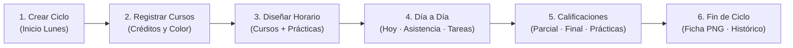
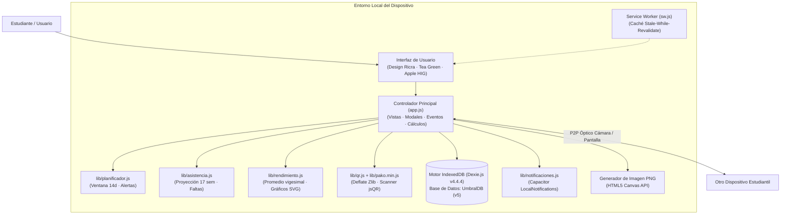

# UNUmbral — Organizador Académico Universitario 100% Offline

> Aplicación web progresiva (PWA) y cliente nativo Android con arquitectura *Local-First* para la gestión integral de ciclos universitarios de 17 semanas, horarios en formato de 12 horas (`AM / PM`), catálogo de cursos con créditos y notas vigesimales (`0 a 20`), control de inasistencias por sesión con alertas reglamentarias (10%, 20%, 30%), seguimiento de tareas por criticidad y transferencia de horarios entre estudiantes mediante códigos QR comprimidos sin servidores ni recolección de datos.

[](https://github.com/TeVerde29/unumbral)
[](https://teverde29.github.io/UNUmbral/)
[](https://dexie.org/)
[](https://developer.mozilla.org/es/docs/Web/JavaScript)
[](tests/)
[](PRIVACY.md)
[](LICENSE)

---

## Tabla de contenidos

1. [Problema y Propósito](#problema-y-propósito)
2. [Acceso y Producción](#acceso-y-producción)
3. [Características Principales](#características-principales)
4. [Flujo de Uso Típico](#flujo-de-uso-típico)
5. [Arquitectura del Sistema](#arquitectura-del-sistema)
6. [Stack Tecnológico](#stack-tecnológico)
7. [Modelo de Datos (IndexedDB)](#modelo-de-datos-indexeddb)
8. [Formatos de Intercambio JSON y Códigos QR](#formatos-de-intercambio-json-y-códigos-qr)
9. [Instalación y Puesta en Marcha](#instalación-y-puesta-en-marcha)
10. [Compilación Nativa de Android (APK)](#compilación-nativa-de-android-apk)
11. [Comandos Disponibles](#comandos-disponibles)
12. [Estructura del Repositorio](#estructura-del-repositorio)
13. [Seguridad, Privacidad y Tratamiento de Datos](#seguridad-privacidad-y-tratamiento-de-datos)
14. [Pruebas Automatizadas](#pruebas-automatizadas)
15. [Decisiones de Diseño y Limitaciones](#decisiones-de-diseño-y-limitaciones)
16. [Licencia y Créditos](#licencia-y-créditos)

---

## Problema y Propósito

En los campus universitarios, laboratorios, bibliotecas y transporte público, la conexión a internet móvil suele ser deficiente, costosa o inexistente. Muchas aplicaciones de horarios dependen de la nube, exigen inicio de sesión obligatorio con correo institucional o comercializan datos de los estudiantes.

**UNUmbral** resuelve este problema mediante una arquitectura cliente **Local-First** y **Zero-Tracking**:
- **100% funcional sin conexión:** Todo se ejecuta en el navegador o en el dispositivo móvil utilizando la base de datos `IndexedDB` y un Service Worker con estrategia de caché *Stale-While-Revalidate*.
- **Diseñado para el régimen universitario real:** Estructura reglamentaria de 17 semanas por ciclo (semana 8 de parciales y semana 17 de finales), cálculo de notas vigesimales con redondeo universitario (`10.5` mínimo aprobatorio), control de inasistencias por sesión y seguimiento de prácticas o empleo en paralelo.
- **Intercambio P2P:** Los estudiantes pueden compartir su horario directamente de cámara a pantalla mediante códigos QR comprimidos con **Deflate (Zlib)**, protegiendo sus notas y tareas personales.

---

## Acceso y Producción

| Entorno / Recurso | Plataforma | Enlace / Ubicación |
|---|---|---|
| **Aplicación Web (PWA)** | GitHub Pages | [https://teverde29.github.io/UNUmbral/](https://teverde29.github.io/UNUmbral/) |
| **Repositorio Oficial** | GitHub | [https://github.com/TeVerde29/unumbral](https://github.com/TeVerde29/unumbral) |
| **Política de Privacidad** | Documento del repositorio | [PRIVACY.md](PRIVACY.md) |
| **Paquete Nativo Android** | Debug APK (local) | `android/app/build/outputs/apk/debug/app-debug.apk` |

---

## Características Principales

### 1. Gestión de Ciclo Académico (17 Semanas)
- Proyección automática de las 17 semanas lectivas obligatorias a partir de cualquier lunes de inicio.
- **Semana 8:** Destacada visualmente para **Exámenes Parciales**.
- **Semana 17:** Destacada para **Exámenes Finales** y balance semestral.
- Vista de progreso temporal con avance en semanas, días transcurridos y registro histórico de semestres previos.

### 2. Horario Académico y Actividades en Formato 12 Horas (`AM / PM`)
- Selección y renderizado en formato de 12 horas con botones independientes `AM / PM` y sin textos recortados.
- **Selector Multidía y Botón Rápido `[Lun a Vie]`:** Permite agendar sesiones recurrentes de una sola vez o añadir horarios diferentes en días específicos.
- **Catálogo de Actividades No Académicas:** Agrupación unificada para prácticas pre-profesionales, empleo, talleres o gimnasio, compartiendo el mismo color y nombre distintivo entre múltiples días.
- Columna horaria fija (`sticky`) y ajuste geométrico adaptativo para sesiones breves ($\le 30$ min).

### 3. Calculadora de Notas en Escala Vigesimal (`0 a 20`)
- Cálculo del promedio final por curso:  
  $$\text{Promedio Final} = \frac{\text{Examen Parcial} + \text{Examen Final} + \text{Promedio de Prácticas}}{3}$$
- Nota mínima aprobatoria de **`10.5`** con estados visuales (Aprobado, En riesgo, Desaprobado, Sin notas).
- Ponderación exacta por créditos académicos de cada asignatura.
- Gráficos vectoriales SVG de evolución por evaluación y simulador de nota requerida para alcanzar una meta.

### 4. Control de Asistencia y Alertas de Inasistencias (Art. 31 RGE)
- Proyección de todas las sesiones de cada curso durante el semestre, deduciendo feriados y cancelaciones.
- Cómputo inteligente: las sesiones pasadas se consideran asistidas por defecto a menos que se registre explícitamente una falta o justificación.
- Bloqueo preventivo de asistencia en fechas futuras.
- **Alertas tempranas de riesgo:** Indicadores visuales y advertencias al cruzar el **10%**, **20%** y **30%** de inasistencias acumuladas.

### 5. Ficha Académica y Certificado en Imagen PNG
- Balance integral de rendimiento: horas lectivas acumuladas, faltas totales, promedio ponderado y asignaturas aprobadas.
- **Exportación en PNG de alta resolución:** Generada en milisegundos mediante Canvas HTML5 nativo sin servidores externos.

### 6. Huecos Libres y Planificador de Tareas
- Detección de ventanas libres entre clases ($\ge 30$ min) con sugerencia de tareas ordenadas por prioridad.
- Fórmula de prioridad combinada:  
  $$\text{Prioridad} = (\text{Importancia} \times 2) + \text{Urgencia}$$
- Comparación estricta por fecha calendario (evita falsos "Hoy" en tareas programadas para el día siguiente).

### 7. Alertas y Notificaciones Locales (Android 100% Offline)
- Avisos previos a clases (30 y 10 minutos antes).
- Recordatorios de tareas clasificados por importancia (niveles 1 a 5 con alarmas insistentes para entregas críticas).
- Resumen matutino diario configurable con respeto automático a periodos de silencio nocturno.

### 8. Compartir Horario por Código QR Comprimido (Deflate Zlib)
- Compresión de alta densidad con biblioteca `pako` (prefijo `UNU1:Z:`), reduciendo la complejidad del código QR en hasta un 60%.
- Soporte para códigos QR multiparte en horarios extensos.
- **Privacidad estricta:** Al compartir el horario solo se transmiten los cursos y horas; las notas, faltas y tareas personales quedan excluidas.

---

## Flujo de Uso Típico



1. **Creación del Ciclo:** Abre UNUmbral, introduce el nombre del semestre (ej. `2026-II`) y la fecha del lunes inaugural.
2. **Registro de Asignaturas:** Da de alta tus cursos con sus créditos oficiales, aula y profesor asignándoles un color pastel distintivo.
3. **Programación del Horario:** Usa el selector con chips multidía (o `[Lun a Vie]`) para añadir tus clases universitarias y tus prácticas laborales.
4. **Seguimiento Diario:** En la pestaña **Hoy**, consulta tus clases, marca asistencias, revisa huecos libres y gestiona entregas.
5. **Registro de Notas:** Ingresa tus evaluaciones para proyectar si superas el umbral de `10.5` y calcular tu promedio ponderado.
6. **Cierre de Semestre:** Genera tu ficha de rendimiento descargable en PNG y archiva el ciclo para comenzar el siguiente.

---

## Arquitectura del Sistema

UNUmbral está diseñado como un cliente desacoplado que corre íntegramente en el navegador o en la WebView de Capacitor, sin ninguna dependencia de backend:



---

## Stack Tecnológico

| Capa | Tecnología | Versión | Responsabilidad |
|---|---|---|---|
| **Lenguaje Core** | JavaScript (ES6+ Vanilla) | Estándar | Lógica reactiva de vistas, cálculos matemáticos vigesimales y manipulación del DOM sin frameworks pesados. |
| **Persistencia de Datos** | Dexie.js | 4.4.4 | Capa relacional estructurada sobre IndexedDB con soporte de transacciones y esquemas versionados. |
| **Compresión de Datos** | Pako (Deflate / Inflate) | 3.0.3 | Compresión binaria en memoria para reducir el tamaño de los códigos QR de horarios. |
| **Motor QR** | QRCode Generator + jsQR | 2.0.4 / 1.4.0 | Generación vectorial de códigos QR y lectura de fotogramas de cámara en tiempo real. |
| **Diseño y Estilos** | CSS3 Nativo (Design Ricra) | Estándar | Tokens Tea Green, paleta pastel accesible, efectos de vidrio (`backdrop-filter`) y temas Claro/Oscuro. |
| **Modo Offline** | Service Worker API | Cache API v5 | Descarga de recursos y ejecución 100% offline tras la primera visita. |
| **Contenedor Móvil** | Capacitor | 8.5.3 | Enlace nativo con Android para alarmas locales en segundo plano (`LocalNotifications`). |
| **Suite de Pruebas** | Node.js Test Runner | Nativo (`node:test`) | Ejecución de 54 pruebas unitarias rápidas sin dependencias externas. |

---

## Modelo de Datos (IndexedDB)

La base de datos local `UmbralDB` utiliza el esquema versionado `v5` en IndexedDB:

```javascript
db.version(5).stores({
  ciclos:      "id, nombre, fecha_inicio, fecha_fin, estado",
  cursos:      "id, nombre, ciclo_id",
  clases:      "id, curso_id, dia_semana, ciclo_id, tipo",
  tareas:      "id, curso_id, fecha_limite, importancia, completada, fecha_creacion, ciclo_id",
  eventos:     "id, curso_id, fecha, tipo, ciclo_id",
  asistencia:  "id, curso_id, clase_id, fecha, estado, &[clase_id+fecha]",
  excepciones: "id, fecha, tipo, clase_id",
  ajustes:     "clave"
});
```

### Entidades Principales:
* **`ciclos`**: Período semestral (nombre, fecha de inicio en lunes, fecha de fin proyectada a 17 semanas y estado activo/archivado).
* **`cursos`**: Asignaturas con créditos, profesor, aula, código, sección, ciclo relativo y estructura de evaluaciones (`parcial`, `final`, `practicas`).
* **`clases`**: Sesiones del horario académico (`tipo: "curso"`) o actividades laborales/personales (`tipo: "actividad"`), con día, hora de inicio y fin.
* **`asistencia`**: Registro por clase y fecha (`presente`, `falta`, `justificada`) con índice compuesto único para evitar duplicidades.
* **`tareas`**: Entregas asociadas a una asignatura o generales, con nivel de importancia (1 a 5) y fecha límite.
* **`ajustes`**: Parámetros de configuración (horas de silencio, ventana de huecos libres, resumen matutino y perfil local del estudiante).

---

## Formatos de Intercambio JSON y Códigos QR

### 1. Horario Compartido Seguro (`UNU1:Z:...` / `unumbral-horario-compartido`)
Diseñado para transferirse entre compañeros sin exponer datos privados:
- Contiene: nombres de asignaturas, créditos, colores, profesor, aula y bloques horarios semanales.
- **Excluye deliberadamente:** notas, evaluaciones, faltas de asistencia, tareas pendientes y datos personales.
- Formato comprimido QR: prefijo `UNU1:Z:` seguido de la carga comprimida con Deflate codificada en Base64URL.

### 2. Copia de Seguridad Completa (`unumbral-backup-total`)
Archivo exportable `UNUmbral_Backup_YYYY-MM-DD.json` con volcado integral de las 8 tablas de la base de datos para respaldo y migración de dispositivo.

---

## Instalación y Puesta en Marcha

### Requisitos Previos
* **Node.js LTS** (v18 o superior)
* Navegador moderno compatible con ES6 y Service Workers (Chrome, Firefox, Safari, Edge, Brave)

### Ejecución Local

1. Clonar el repositorio:
   ```bash
   git clone https://github.com/TeVerde29/unumbral.git
   cd unumbral
   ```

2. Instalar dependencias:
   ```bash
   npm install
   ```

3. Iniciar un servidor HTTP local:
   ```bash
   # Opción A: con npx serve
   npx serve .

   # Opción B: con Python 3
   python -m http.server 8080
   ```

4. Abrir en el navegador:
   ```text
   http://localhost:8080
   ```

---

## Compilación Nativa de Android (APK)

UNUmbral incluye soporte nativo mediante Capacitor para empaquetar la PWA en un APK de Android con notificaciones locales independientes de la conexión a internet.

### Requisitos
- **Android Studio** (con SDK de Android instalado) o Android Command Line Tools con Java JDK 17+.

### Pasos:

1. Compilar los archivos web y sincronizar con el proyecto Android:
   ```bash
   npm run sync
   ```

2. Compilar el APK de depuración directamente con Gradle:
   ```bash
   cd android
   ./gradlew assembleDebug
   ```
   El archivo generado se encontrará en:
   ```text
   android/app/build/outputs/apk/debug/app-debug.apk
   ```

3. (Opcional) Abrir en Android Studio para depurar en dispositivo físico o emulador:
   ```bash
   npx cap open android
   ```

---

## Comandos Disponibles

| Comando | Propósito |
|---|---|
| `npm test` | Ejecuta la suite completa de 54 pruebas unitarias con el runner nativo de Node.js. |
| `npm run build:web` | Empaqueta los archivos web de producción en la carpeta `www/`. |
| `npm run sync` | Ejecuta `build:web` y sincroniza los cambios con el proyecto nativo `android/`. |
| `npx cap open android` | Abre el proyecto de Android en Android Studio. |

---

## Estructura del Repositorio

```text
unumbral/
├── index.html               # Interfaz de usuario semántica y accesible (HTML5)
├── app.js                   # Controlador de la aplicación, vistas y eventos
├── estilos.css              # Sistema de diseño Design Ricra (Tea Green)
├── manifest.json            # Manifiesto PWA para instalación en pantalla de inicio
├── sw.js                    # Service Worker con caché offline Stale-While-Revalidate
├── PRIVACY.md               # Política de privacidad completa y formal
├── LICENSE                  # Licencia de código abierto MIT
├── package.json             # Dependencias del proyecto y scripts de ejecución
├── android/                 # Proyecto nativo Android Capacitor
│   └── app/build.gradle     # Configuración de compilación Gradle
├── lib/                     # Módulos y bibliotecas cliente
│   ├── dexie.min.js         # Base de datos IndexedDB Dexie.js v4.4.4
│   ├── pako.min.js          # Compresión Deflate / Inflate (Zlib)
│   ├── qrcode.min.js        # Generador de códigos QR
│   ├── jsqr.min.js          # Lector de códigos QR mediante cámara
│   ├── qr.js                # Algoritmo de serialización y descompresión QR
│   ├── asistencia.js        # Proyección de 17 semanas y reglas de inasistencias
│   ├── rendimiento.js       # Cálculo vigesimal, promedio ponderado y SVG
│   ├── planificador.js      # Programación de alertas y horas de silencio
│   ├── notificaciones.js    # Puente con Capacitor LocalNotifications
│   ├── huecos.js            # Algoritmo de detección de ventanas libres
│   ├── prioridad.js         # Matriz de urgencia e importancia de tareas
│   ├── plataforma.js        # Detección de entorno (Web PWA vs Android APK)
│   ├── ajustes.js           # Validación y sanitización de configuración
│   └── deeplink.js          # Manejo de accesos directos y enlaces nativos
├── scripts/
│   └── build-web.js         # Script de preparación del bundle en www/
└── tests/                   # Suite de pruebas unitarias
    ├── asistencia.test.js   # Pruebas de asistencia, faltas y umbrales (10%, 20%, 30%)
    ├── ciclo.test.js        # Pruebas de proyección semestral (17 semanas)
    ├── db-v4.test.js        # Pruebas de esquema de base de datos y sanitización
    ├── deeplink.test.js     # Pruebas de enrutamiento y esquemas URL
    ├── huecos.test.js       # Pruebas de detección de intervalos libres entre clases
    ├── planificador.test.js # Pruebas de alertas de clases, tareas y silencio
    ├── prioridad.test.js    # Pruebas de matriz de urgencia y orden de tareas
    ├── qr.test.js           # Pruebas de compresión Deflate y roundtrip QR
    ├── rendimiento.test.js  # Pruebas de promedio ponderado y gráficas SVG
    └── unumbral.test.js     # Pruebas de escala vigesimal, horas 12h, días calendario y DOM IDs
```

---

## Seguridad, Privacidad y Tratamiento de Datos

UNUmbral fue concebido bajo el principio de **Privacidad por Defecto (*Privacy by Design*)**:

1. **Almacenamiento 100% Local:** Ningún dato viaja a servidores en la nube. La información reside únicamente en la base de datos `IndexedDB` del dispositivo.
2. **Cero Rastreo:** No se cargan scripts de analítica, cookies de seguimiento ni identificadores publicitarios.
3. **Uso Restringido de la Cámara:** Se utiliza en tiempo real para leer códigos QR mediante `jsQR` procesando los fotogramas en la memoria RAM. Ninguna fotografía se almacena ni se transmite.
4. **Notificaciones Autónomas:** Programadas en el gestor de alarmas nativo del sistema operativo (sin Firebase Cloud Messaging ni servidores push).
5. **Derecho de Supresión:** El usuario puede exportar una copia completa en `.json` o eliminar todos sus registros de forma inmediata mediante el botón *"Vaciar Base de Datos"* en Ajustes.

Para mayores detalles, consulta el documento completo de [Política de Privacidad](PRIVACY.md).

---

## Pruebas Automatizadas

UNUmbral cuenta con una suite de **54 pruebas unitarias** que se ejecutan directamente con el motor nativo de pruebas de Node.js:

```bash
npm test
```

### Cobertura de las Pruebas:
- **`tests/ciclo.test.js`**: Cálculo exacto de las 17 semanas con inicio en lunes, finalización en domingo, semana 8 de parciales y semana 17 de finales.
- **`tests/asistencia.test.js`**: Proyección semestral de sesiones, exclusión de feriados y cancelaciones, cómputo de faltas por defecto y activación de alertas al 10%, 20% y 30%.
- **`tests/unumbral.test.js`**: Cálculo de escala vigesimal (0-20), formato de 12 horas AM/PM, normalización de paleta pastel, posicionamiento en timeline con solapamientos paralelos, consistencia estricta de selectores DOM e integridad en la comparación de días calendario relativos.
- **`tests/rendimiento.test.js`**: Promedio ponderado por créditos, simulador de notas requeridas y generación de gráficos comparativos SVG.
- **`tests/huecos.test.js`**: Detección de ventanas libres entre cursos y orden de sugerencia de tareas.
- **`tests/prioridad.test.js`**: Algoritmo de puntuación de prioridad, matriz de tareas y agrupación semanal.
- **`tests/planificador.test.js`**: Programación de alertas a 30 y 10 minutos, tareas críticas nivel 5 insistentes y respeto de horas de silencio.
- **`tests/qr.test.js`**: Codificación Base64URL, compresión Deflate/Zlib (prefijo `UNU1:Z:`), ensamble multiparte y roundtrip de datos.
- **`tests/deeplink.test.js`**: Manejo de accesos directos y enlaces `unumbral://`.
- **`tests/db-v4.test.js`**: Verificación de campos obligatorios, valores por defecto y sanitización de ajustes.

---

## Decisiones de Diseño y Limitaciones

1. **Sin dependencia de servidores:** Si el usuario borra la caché o los datos del navegador sin haber exportado un respaldo `.json`, los datos se pierden. Por ello se ofrece un acceso directo y visible a la creación de copias de seguridad.
2. **Transferencia de Horario sin Notas:** Al escanear un horario ajeno, solo se importan las sesiones y cursos para no invadir la privacidad académica del compañero emisor.
3. **Escala Vigesimal Universitaria:** La fórmula de promedios adopta el estándar reglamentario `(Parcial + Final + Promedio Prácticas) ÷ 3` con umbral de `10.5`. Si una facultad utiliza otra ponderación porcentual, puede ajustarse en el catálogo de cursos.

---

## Licencia y Créditos

Este proyecto se distribuye bajo la licencia de código abierto **MIT**. Puedes consultar el texto completo en [LICENSE](LICENSE).

Desarrollado por **Té Verde**  
Estudiante de Ingeniería de Sistemas e Informática — UNU  
GitHub: [@TeVerde29](https://github.com/TeVerde29)  
Contacto: [hikih020@gmail.com](mailto:hikih020@gmail.com)
