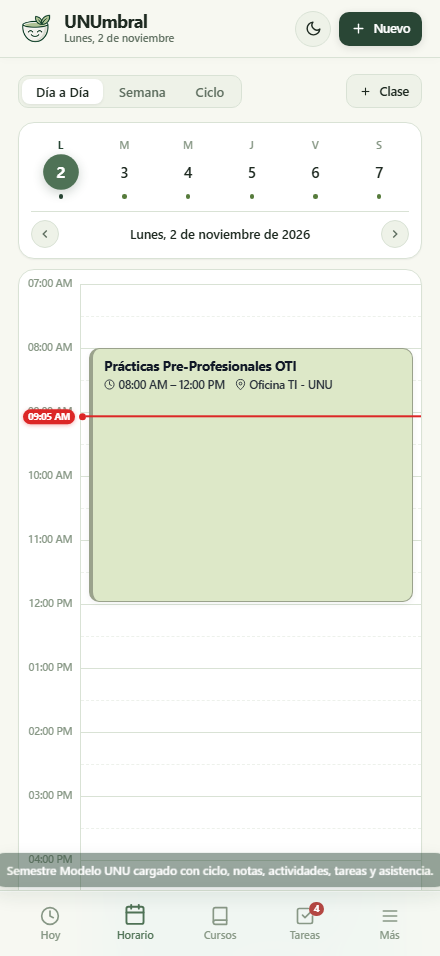
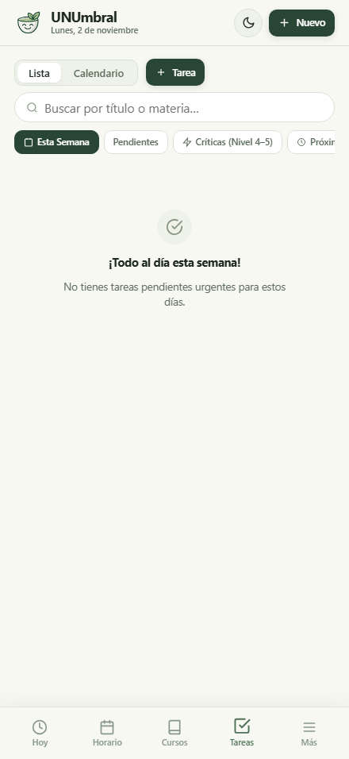
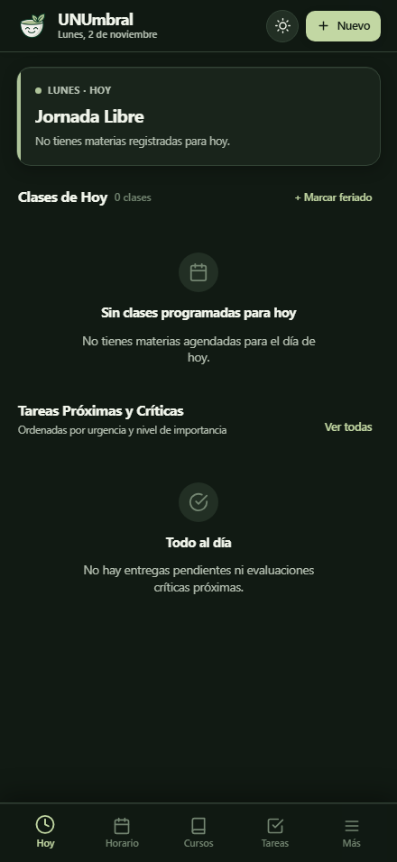
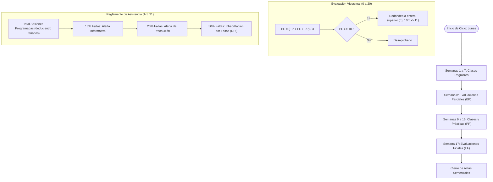
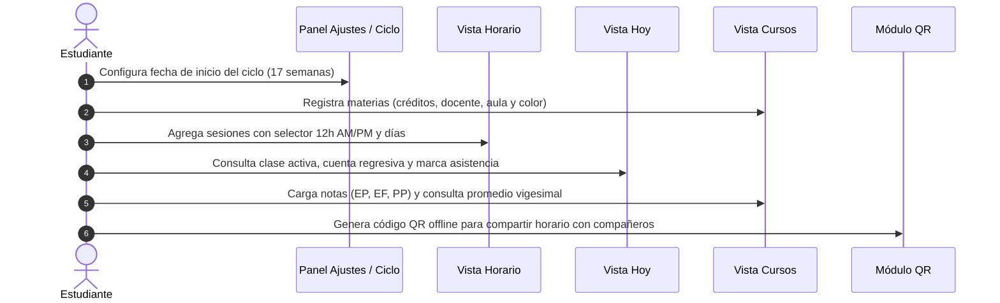

# UNUmbral — Organizador Académico Universitario 100% Offline

> Aplicación web progresiva (PWA) instalable y cliente nativo Android con arquitectura Local-First. Diseñada para la gestión integral de ciclos universitarios de 17 semanas, horarios semanales en formato 12 horas (AM/PM), calificaciones en escala vigesimal (0 a 20) con umbral aprobatorio de 10.5, control de inasistencias por sesión con alertas preventivas (10%, 20% y 30%), detección de ventanas libres entre clases y transferencia de horarios mediante códigos QR comprimidos con Zlib Deflate sin servidores ni conexión a internet.

[](https://github.com/TeVerde29/UNUmbral)
[](https://teverde29.github.io/UNUmbral/)
[](https://dexie.org/)
[](https://capacitorjs.com/)
[](tests/)
[](LICENSE)

---

## Capturas de Pantalla (Mobile — iPhone 16 Pro Max · 440 × 956 px)

Todas las capturas han sido obtenidas directamente de la aplicación en ejecución móvil con los datos del Semestre Modelo Universitario cargados:

| Vista Hoy (`view-hoy`) | Parrilla Semanal (`view-horario`) |
|:---:|:---:|
|  |  |

| Asignaturas y Notas (`view-cursos`) | Planificador de Tareas (`view-tareas`) |
|:---:|:---:|
|  |  |

| Transferencia por QR (`modal-qr`) | Modo Oscuro / Ajustes (`view-ajustes`) |
|:---:|:---:|
|  |  |

---

## Tabla de Contenidos

1. [Descripción del Proyecto](#descripción-del-proyecto)
2. [Problema que Resuelve](#problema-que-resuelve)
3. [Características Principales](#características-principales)
4. [Reglas Académicas del Dominio](#reglas-académicas-del-dominio)
5. [Stack Tecnológico](#stack-tecnológico)
6. [Arquitectura del Sistema](#arquitectura-del-sistema)
7. [Modelo de Datos Local (IndexedDB)](#modelo-de-datos-local-indexeddb)
8. [Formato de Transferencia QR Offline](#formato-de-transferencia-qr-offline)
9. [Requisitos del Sistema](#requisitos-del-sistema)
10. [Instalación y Puesta en Marcha](#instalación-y-puesta-en-marcha)
11. [Flujo de Uso Paso a Paso](#flujo-de-uso-paso-a-paso)
12. [Comandos Disponibles](#comandos-disponibles)
13. [Compilación Nativa Android (APK)](#compilación-nativa-android-apk)
14. [Pruebas Automatizadas](#pruebas-automatizadas)
15. [Seguridad y Privacidad (Zero-Tracking)](#seguridad-y-privacidad-zero-tracking)
16. [Licencia](#licencia)
17. [Autor y Créditos](#autor-y-créditos)

---

## Descripción del Proyecto

**UNUmbral** es una aplicación diseñada para estudiantes universitarios que necesitan administrar su semestre académico de forma autónoma, sin depender de redes Wi-Fi institucionales congestionadas, planes de datos móviles ni servicios en la nube que recopilen su información privada.

Bajo una arquitectura **Local-First**, la aplicación almacena toda la información de cursos, horarios, asistencias, notas y tareas directamente en el dispositivo mediante `IndexedDB` a través de la biblioteca Dexie.js. La aplicación se distribuye como Progressive Web App (PWA) instalable en el navegador y como aplicación nativa Android construida con Capacitor.

---

## Problema que Resuelve

- **Conectividad deficiente en campus universitarios:** En pabellones, sótanos de laboratorios y trayectos de transporte público, la conexión a internet suele ser inestable o inexistente. UNUmbral carga de forma inmediata y funciona al 100% sin conexión gracias a su Service Worker con estrategia de caché *Stale-While-Revalidate*.
- **Rastreo y monetización de datos estudiantiles:** Muchas herramientas comerciales exigen cuentas obligatorias, rastrean hábitos de navegación y sincronizan agendas en servidores de terceros. UNUmbral implementa una política de **Zero-Tracking**: no incluye analíticas, no utiliza cookies de seguimiento y no se comunica con ningún servidor externo.
- **Dificultad para coordinar horarios entre compañeros:** Compartir la carga horaria del ciclo suele requerir capturas de pantalla estáticas o reescribir manualmente los bloques. UNUmbral comprime la estructura académica completa mediante el algoritmo Zlib Deflate y genera un código QR de alta densidad que puede escanearse de pantalla a pantalla o desde la galería sin exponer calificaciones personales.

---

## Características Principales

### 1. Gestión Integral del Semestre (17 Semanas)
- Proyección automática del semestre a 17 semanas continuas a partir del lunes de inicio seleccionado.
- Señalización de hitos reglamentarios: **Semana 8** para evaluaciones parciales y **Semana 17** para evaluaciones finales y cierre de actas.
- Registro de excepciones calendarias: marcado de días completos como feriados o suspensión puntual de clases individuales.

### 2. Horario Semanal en Formato 12 Horas (AM/PM)
- Selector de hora con formato amigable de 12 horas (AM/PM) e intervalos de 5 minutos.
- Atajos de selección múltiple de días (incluye botón rápido `[Lun a Vie]`).
- Visualización por defecto en Parrilla Semanal de 7 días (lunes a domingo) con navegación continua y selector de días estilo Apple Calendar.
- Diferenciación visual entre materias lectivas obligatorias y actividades no académicas (talleres, prácticas preprofesionales o trabajo).

### 3. Panel Diario "Hoy" con Estado en Vivo
- Saludo contextual según la hora del día y fecha actual en lenguaje natural.
- Indicador en vivo de la clase en curso o de la próxima sesión con cuenta regresiva.
- **Filtrado de cancelaciones:** las clases suspendidas o en días feriados no se muestran como sesiones activas.
- Hoja modal táctil inferior (*Bottom Sheet*) para marcar asistencia inmediata en 4 estados: *Asistí*, *Falté*, *Justificada* o *Anular*.

### 4. Control Preventivo de Inasistencias
- Proyección de todas las sesiones del semestre deduciendo feriados y suspensiones.
- Cómputo histórico por defecto: las sesiones pasadas se consideran asistidas automáticamente a menos que se registre inasistencia o justificación expresa.
- Alertas visuales anticipadas al alcanzar el **10%**, **20%** y el límite crítico del **30%** de inasistencias sobre el total de clases programadas.

### 5. Calificaciones en Escala Vigesimal y Simulador Predictivo
- Registro de notas en escala formal peruana de 0 a 20 con hasta 2 decimales para Examen Parcial ($EP$), Examen Final ($EF$) y Promedio de Prácticas ($PP$).
- Cálculo de promedio final con redondeo reglamentario favorable: nota mínima aprobatoria de **10.5** (redondeo a 11 en actas).
- Promedio Ponderado Semestral ($PPS$) calculado por créditos académicos.
- **Simulador de Meta Académica:** cálculo de la nota exacta requerida en el Examen Final para alcanzar la aprobación (10.5) o metas superiores (14, 16 o 18).

### 6. Planificador de Tareas y Matriz de Criticidad
- Clasificación de tareas en 5 niveles de importancia.
- Agrupación por urgencia (*Para hoy*, *Esta semana*, *Próximas* y *Completadas*).
- Marcado de completado rápido con un solo toque desde tarjetas de tarea.

### 7. Detección Inteligente de Huecos Libres
- Análisis de la jornada diaria para detectar intervalos libres entre clases ($\ge 30$ minutos).
- Recomendación contextual de tareas pendientes acordes a la duración del hueco disponible.

### 8. Transferencia Óptica de Horarios por Código QR Offline
- Exportación del horario académico completo serializado en formato JSON minificado versión 3 con compresión binaria Zlib Deflate y codificación Base64 URL-safe (prefijo `UNU1:Z:`).
- **Protección de privacidad:** la exportación excluye estrictamente notas, registros de asistencia, faltas acumuladas y tareas personales.
- Soporte para códigos QR multipartes cuando el volumen de clases supera el límite de densidad física.
- Lector QR integrado con soporte para cámara en vivo o carga de capturas desde la galería.

### 9. Entorno de Demostración y Respaldo
- Botón **"Cargar Semestre Modelo"** para poblar el sistema con una carga universitaria completa (6 asignaturas, notas, actividades, tareas y faltas de ejemplo).
- Exportación e importación de copias de seguridad completas en formato JSON.
- Generación y descarga gráfica de reportes de fin de ciclo en formato de imagen PNG.

---

## Reglas Académicas del Dominio



1. **Estructura Semestral de 17 Semanas:** Todo ciclo académico tiene una duración estricta de 119 días calendario (17 semanas continuas), iniciando un lunes y finalizando en domingo.
2. **Evaluación Vigesimal Oficial:** Las calificaciones se sitúan en el rango de 0.00 a 20.00 puntos. La fórmula estándar de promedio de asignatura es:
   $$\text{Promedio Final} = \frac{\text{Examen Parcial} + \text{Examen Final} + \text{Promedio Prácticas}}{3}$$
3. **Criterio de Redondeo Favorable:** El umbral de aprobación es 10.5. Toda fracción decimal igual o superior a 0.5 puntos se redondea favorablemente al número entero inmediato superior (10.5 equivale a 11).
4. **Promedio Ponderado Semestral ($PPS$):**
   $$PPS = \frac{\sum_{i=1}^{n} (\text{Nota}_i \times \text{Créditos}_i)}{\sum_{i=1}^{n} \text{Créditos}_i}$$
5. **Límite de Inasistencias (Art. 31 del Reglamento de Estudios):** Acumular el 30% o más de faltas sobre las sesiones lectivas efectivas del semestre causa la inhabilitación automática de la asignatura.

---

## Stack Tecnológico

| Capa | Tecnología | Versión | Responsabilidad |
|---|---|---|---|
| **Núcleo de Aplicación** | JavaScript Vanilla (ES6+) | Estándar moderno | Lógica de negocio modular, algoritmos de proyección y manipulación del DOM. |
| **Persistencia Local** | Dexie.js | 4.4.4 | Capa estructurada sobre IndexedDB con versionado, transacciones e índices. |
| **Compresión Binaria** | Pako (Zlib Deflate/Inflate) | 3.0.3 | Compresión en memoria para códigos QR de alta densidad. |
| **Generación Óptica QR** | qrcode-generator | 2.0.4 | Renderizado gráfico vectorial de códigos QR en Canvas. |
| **Reconocimiento QR** | jsQR | 1.4.0 | Procesamiento de patrones QR desde cámara o imágenes de galería. |
| **Contenedor Móvil** | Capacitor Android | 8.5.3 | Puente nativo para compilación de APK y servicios del sistema operativo. |
| **Notificaciones Locales** | `@capacitor/local-notifications` | 8.3.1 | Alarmas de clases y entregas en el planificador del dispositivo Android. |
| **Diseño y Estilos** | CSS3 Nativo (Design Ricra) | Estándar | Tokens de diseño Tea Green, efecto acrílico (`backdrop-filter`) y modos claro/oscuro. |
| **Caché Offline** | Service Worker API | Cache API v5 | Descarga de recursos y operatividad autónoma sin internet. |
| **Pruebas Unitarias** | Node.js Test Runner | Nativo (`node:test`) | Suite automatizada de 68 pruebas unitarias sin dependencias externas. |
| **Testing E2E y Capturas** | Playwright | 1.64.1 | Automatización de navegador para pruebas de navegación y capturas móviles. |

---

## Arquitectura del Sistema

```text
UNUmbral/
├── index.html                     # Vistas semánticas y hojas modales (HTML5)
├── app.js                         # Controlador principal, ciclo de vida e inicialización
├── estilos.css                    # Tokens visuales Tea Green, layout responsive y temas
├── manifest.json                  # Manifiesto de instalación PWA
├── sw.js                          # Service Worker con estrategia Stale-While-Revalidate
├── PRIVACY.md                     # Declaración formal de privacidad y Zero-Tracking
├── LICENSE                        # Licencia de código abierto MIT
├── package.json                   # Manifiesto de dependencias y scripts de automatización
├── android/                       # Proyecto nativo Android para Capacitor
│   ├── app/build.gradle           # Configuración del módulo Android (AGP 8.13.0)
│   └── gradle/wrapper/            # Gradle Wrapper (versión 8.14.3)
├── lib/                           # Módulos desacoplados y algoritmos de dominio
│   ├── dexie.min.js               # Motor de persistencia IndexedDB
│   ├── pako.min.js                # Compresión/descompresión Zlib Deflate
│   ├── qrcode.min.js              # Generador gráfico de QR
│   ├── jsqr.min.js                # Decodificador óptico de QR
│   ├── qr.js                      # Serialización v1/v2/v3 y codificación Base64URL
│   ├── asistencia.js              # Proyección de 17 semanas y cálculo de umbrales
│   ├── rendimiento.js             # Promedios vigesimales, simulador y gráficos SVG
│   ├── planificador.js            # Planificación de alertas y rangos de silencio
│   ├── notificaciones.js          # Adaptador de notificaciones locales para Capacitor
│   ├── huecos.js                  # Detección de ventanas libres entre clases
│   ├── prioridad.js               # Matriz de urgencia e importancia de tareas
│   ├── plataforma.js              # Detección del entorno de ejecución (Web PWA vs APK)
│   ├── ajustes.js                 # Validación y sanitización del almacén de configuración
│   ├── deeplink.js                # Enrutador de enlaces unumbral:// y hashes
│   ├── utils/
│   │   └── safeHtml.js            # Prevención de inyección XSS con escapado contextual
│   ├── services/                  # Servicios de acceso a base de datos
│   │   ├── tareasService.js       # Operaciones de tareas
│   │   ├── cursosService.js       # Gestión de cursos y cascada de clases
│   │   └── asistenciaService.js   # Registro y consulta de inasistencias
│   └── views/                     # Lógica de renderizado de vistas
│       ├── hoyView.js             # Tarjeta de clase activa y saludo contextual
│       ├── horarioView.js         # Cálculo de solapamientos en parrilla semanal
│       ├── cursosView.js          # Estados de aprobación y notas faltantes
│       └── tareasView.js          # Agrupación y clasificación de tareas
├── scripts/
│   ├── build-web.js               # Generador del bundle para publicación web y sincronización
│   └── capturar-pantallas-mobile.js # Generación automatizada de capturas iPhone 16 Pro Max (440x956)
└── tests/                         # Suite completa de pruebas unitarias
    ├── asistencia.test.js         # Pruebas de asistencia y umbrales (10/20/30%)
    ├── ciclo.test.js              # Pruebas de proyección de 17 semanas y parciales/finales
    ├── db-v4.test.js              # Pruebas de esquemas y claves de IndexedDB
    ├── deeplink.test.js           # Pruebas de deep linking y esquemas URL
    ├── huecos.test.js             # Pruebas de detección de intervalos libres
    ├── planificador.test.js       # Pruebas de programación de recordatorios
    ├── prioridad.test.js          # Pruebas de cálculo de prioridad de tareas
    ├── qr.test.js                 # Pruebas de compresión Deflate y deserialización QR
    ├── rendimiento.test.js        # Pruebas de notas vigesimales y ponderaciones
    ├── services.test.js           # Pruebas de capa de servicios aislados
    ├── views.test.js              # Pruebas de renderizadores de vista
    └── unumbral.test.js           # Pruebas de selectores DOM y formato 12h
```

---

## Modelo de Datos Local (IndexedDB)

La base de datos se denomina `UmbralDB` (versión 5) gestionada mediante Dexie.js:

```javascript
db.version(5).stores({
  ciclos:      "id, nombre, fecha_inicio, fecha_fin, estado",
  cursos:      "id, nombre, ciclo_id",
  clases:      "id, curso_id, dia_semana, ciclo_id, tipo",
  tareas:      "id, curso_id, fecha_limite, importancia, completada, fecha_creacion, ciclo_id",
  eventos:     "id, curso_id, fecha, tipo, ciclo_id",
  asistencia:  "id, curso_id, clase_id, fecha, estado, &[clase_id+fecha]",
  excepciones: "id, fecha, tipo, clase_id",
  ajustes:     "clave"
});
```

- **Índice único compuesto `&[clase_id+fecha]`:** Garantiza que no existan registros duplicados de asistencia para una misma sesión en un día específico.
- **Tabla `excepciones`:** Registra feriados institucionales y suspensiones de clase que se descuentan automáticamente del cálculo de inasistencias.

---

## Formato de Transferencia QR Offline

La cadena serializada utiliza el prefijo `UNU1:Z:` seguido por los bytes comprimidos con Deflate codificados en Base64 URL-safe. El JSON interno contiene exclusivamente datos académicos públicos:

```json
{
  "v": 3,
  "c": [
    {
      "id": 0,
      "n": "Inteligencia Artificial y Sistemas Expertos",
      "p": "Dr. Agurto",
      "a": "Aula 1",
      "k": "#BAE6FD",
      "cr": 4,
      "ci": "IX",
      "co": "obligatorio",
      "g": "A"
    }
  ],
  "k": [
    {
      "c": 0,
      "d": "L",
      "i": "1630",
      "f": "1900",
      "t": "curso"
    }
  ],
  "ci": [
    "Ciclo 2026-II",
    "2026-08-17",
    "2026-12-13"
  ]
}
```

> **Privacidad garantizada:** Las notas parciales, exámenes finales, historial de faltas, tareas personales y notas privadas quedan completamente excluidos de la carga útil del código QR.

---

## Requisitos del Sistema

| Entorno | Requisito mínimo |
|---|---|
| **Navegadores Soportados** | Google Chrome 90+, Mozilla Firefox 90+, Apple Safari 14+, Microsoft Edge 90+ |
| **Dispositivos Móviles** | Android 8.0+ (Chrome/Samsung Internet) o iOS 14+ (Safari con soporte PWA) |
| **Entorno de Desarrollo** | Node.js 20 LTS o superior |
| **Compilación Nativa Android** | Android Studio, Android SDK (API 34+), Java JDK 17 o JDK 21 |
| **Herramienta de Construcción Android** | Gradle Wrapper 8.14.3 (provisto en el repositorio) |

---

## Instalación y Puesta en Marcha

### 1. Clonar el Repositorio
```bash
git clone https://github.com/TeVerde29/UNUmbral.git
cd UNUmbral
```

### 2. Instalar Dependencias
```bash
npm install
```

### 3. Ejecutar las Pruebas Unitarias
```bash
npm test
```

### 4. Iniciar un Servidor Local de Desarrollo
Puedes utilizar cualquier servidor estático:
```bash
npx serve .
```
O usando Python:
```bash
python -m http.server 8080
```

Abre en tu navegador la dirección:
```text
http://localhost:8080
```

---

## Flujo de Uso Paso a Paso



1. **Configurar el Ciclo:** En la pestaña Ajustes o el selector superior, ingresa el nombre del semestre y la fecha del lunes de inicio. El sistema proyectará automáticamente el término en la semana 17.
2. **Cargar Semestre Modelo (Opcional):** Si deseas probar la aplicación con datos realistas de inmediato, ve a la pestaña **Ajustes** y pulsa **"Cargar Semestre Modelo"**.
3. **Organizar el Horario:** En la pestaña **Horario**, agrega las clases indicando hora de inicio, hora de fin (formato 12 horas AM/PM) y días de dictado con los selectores rápidos.
4. **Seguimiento Diario:** En la pestaña **Hoy**, visualiza la sesión en curso o la próxima clase con cuenta regresiva. Pulsa sobre cualquier tarjeta para registrar asistencia (*Asistí*, *Falté* o *Justificada*).
5. **Control de Evaluaciones:** En la pestaña **Cursos**, registra las calificaciones parciales de cada materia para verificar si se supera el umbral de 10.5 o abre el **Simulador** para conocer la nota necesaria en el examen final.
6. **Compartir Horario:** Desde el menú de Horario o Ajustes, pulsa **Compartir Horario** para generar el código QR comprimido y permitir que otro estudiante lo escanee con su cámara o desde una foto.

---

## Comandos Disponibles

| Comando | Descripción |
|---|---|
| `npm test` | Ejecuta la suite de 68 pruebas unitarias con el runner nativo de Node.js (`node:test`). |
| `npm run build:web` | Empaqueta y copia los archivos de producción hacia el directorio `www/`. |
| `npm run sync` | Ejecuta `build:web` y sincroniza los recursos web con el proyecto nativo `android/` mediante Capacitor. |
| `npm run test:e2e` | Ejecuta las pruebas de integración extremo a extremo con Playwright. |
| `node scripts/capturar-pantallas-mobile.js` | Genera capturas de pantalla móviles en resolución iPhone 16 Pro Max (440 × 956 px) en la carpeta `img/`. |

---

## Compilación Nativa Android (APK)

Para compilar el archivo APK instalable en dispositivos Android:

1. **Sincronizar el proyecto web con Android:**
   ```bash
   npm run sync
   ```

2. **Compilar el APK de depuración con Gradle:**
   ```bash
   cd android
   ./gradlew assembleDebug --no-daemon
   ```

3. **Ubicación del paquete generado:**
   ```text
   android/app/build/outputs/apk/debug/app-debug.apk
   ```

---

## Pruebas Automatizadas

El proyecto cuenta con una cobertura de **68 pruebas unitarias verificadas**:

```bash
node --test tests/*.test.js
```

### Cobertura de Suites:
- `tests/ciclo.test.js`: Proyección exacta de 17 semanas finalizando en domingo, marcación de semana 8 (parciales) y semana 17 (finales).
- `tests/asistencia.test.js`: Exclusión de feriados y cancelaciones, cálculo por defecto de sesiones pasadas y detección de umbrales del 10%, 20% y 30%.
- `tests/rendimiento.test.js`: Cálculo vigesimal con redondeo a 10.5, promedios ponderados por créditos, simulador de notas y gráficos SVG.
- `tests/qr.test.js`: Compresión Zlib Deflate, codificación Base64URL, fragmentación multiparte y rechazo de cargas corruptas.
- `tests/prioridad.test.js`: Matriz de criticidad e importancia combinada para ordenamiento de tareas.
- `tests/huecos.test.js`: Detección de ventanas libres entre clases y filtrado de tareas sugeridas.
- `tests/planificador.test.js`: Programación de alertas de clases y respeto del rango de silencio nocturno.
- `tests/services.test.js`: Aislamiento de capas CRUD de tareas, cursos y asistencias.
- `tests/views.test.js`: Exclusión de clases suspendidas en el estado de clase activa de hoy.
- `tests/unumbral.test.js`: Conversiones 12h/24h, adaptación de límites del timeline y prevención de inyección XSS con `safeHtml`.

---

## Seguridad y Privacidad (Zero-Tracking)

- **Almacenamiento Local Soberano:** Toda la información se conserva exclusivamente en el almacenamiento local del dispositivo (`IndexedDB`). No se envía ningún dato a servidores remotos.
- **Sin Analíticas ni Cookies de Terceros:** La aplicación no incluye bibliotecas de telemetría, Google Analytics ni scripts de seguimiento de comportamiento.
- **Prevención de Cross-Site Scripting (XSS):** Todo contenido ingresado por el usuario o deserializado desde códigos QR externos es procesado a través de la función `safeHtml` (`lib/utils/safeHtml.js`) antes de inyectarse en el DOM.
- **Sanitización de Datos Importados:** Los colores y cadenas provenientes de códigos QR son validados contra expresiones regulares estrictas para evitar inyecciones de estilos o protocolos no seguros.

---

## Licencia

Este proyecto se distribuye bajo la licencia **MIT**. Consulta el archivo [LICENSE](LICENSE) para más detalles.

---

## Autor y Créditos

**Té Verde**  
Estudiante de Ingeniería de Sistemas e Informática — Universidad Nacional de Ucayali (UNU)  
- GitHub: [@TeVerde29](https://github.com/TeVerde29)  
- Correo: [hikih020@gmail.com](mailto:hikih020@gmail.com)  
- Repositorio oficial: [https://github.com/TeVerde29/UNUmbral](https://github.com/TeVerde29/UNUmbral)  
- Versión en línea (PWA): [https://teverde29.github.io/UNUmbral/](https://teverde29.github.io/UNUmbral/)
